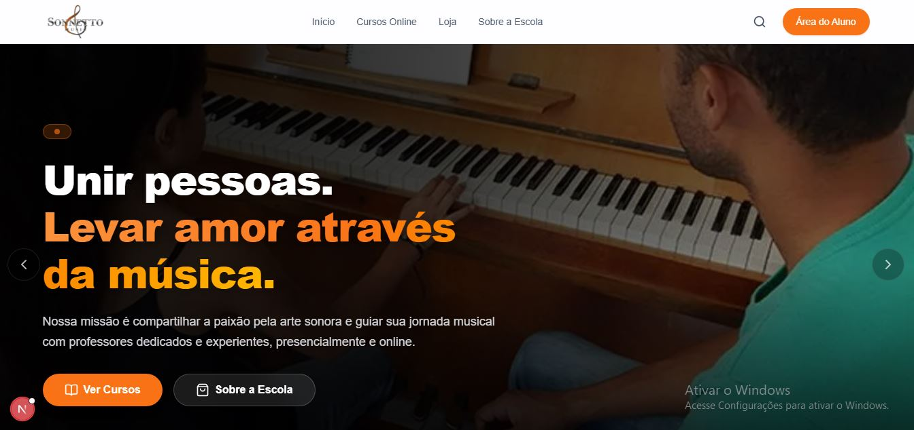
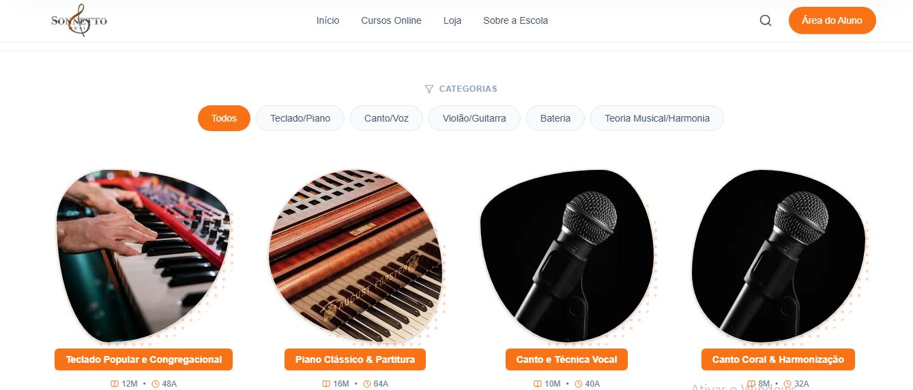
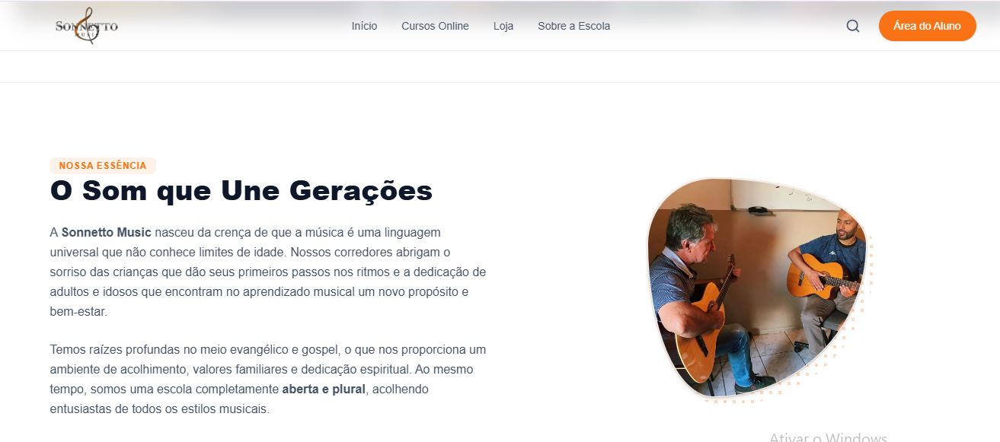
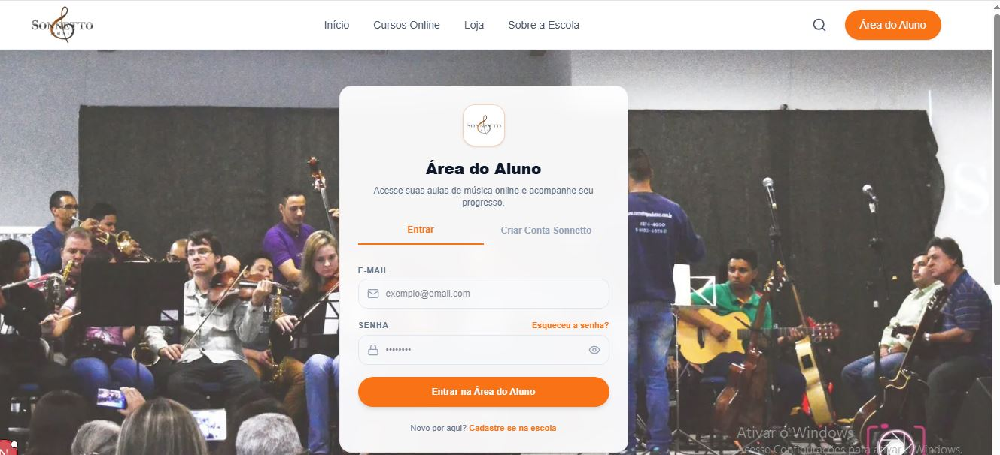

# 🎵 Sonnetto Music - Web Application

Plataforma web moderna desenvolvida em **Next.js** para a escola de música **Sonnetto Music**, oferecendo cursos presenciais e online, área do aluno e apresentação institucional.

## 🚀 Sobre o Projeto
O projeto foi desenhado com foco na experiência do usuário, apresentando um design limpo, identidade visual em tons de laranja quente e branco, tipografia responsiva e elementos visuais orgânicos (*blobs* com gradientes pontilhados).

## 📌 Funcionalidades
- **Página Inicial:** Banner dinâmico, carrossel e destaques da escola.
- **Sobre a Escola:** História, valores, infraestrutura e diferenciais com design em blocos orgânicos.
- **Cursos Online:** Catálogo interativo de cursos filtráveis por categoria (Teclado, Canto, Violão, Bateria e Teoria Musical).
- **Área do Aluno:** Espaço exclusivo de login e gestão para estudantes.

## 🖼️ Capturas de Tela (Prints)

| Página Inicial | Página de Cursos |
| :---: | :---: |
|  |  |

| Página Sobre a Escola | Área de Login |
| :---: | :---: |
|  |  |

## 🛠️ Tecnologias Utilizadas
- **Next.js (App Router)**
- **React**
- **Tailwind CSS**
- **TypeScript**
- **Lucide React** (Ícones)
